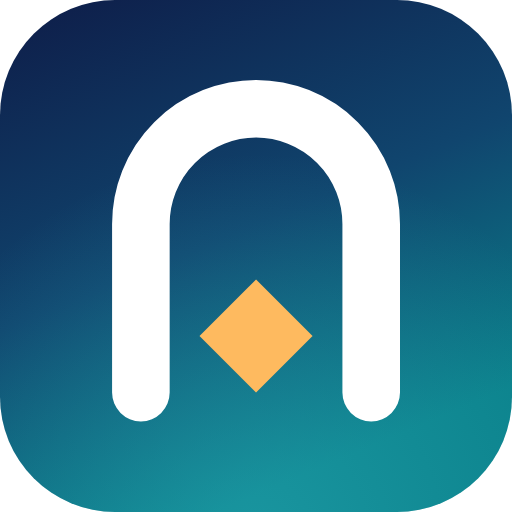
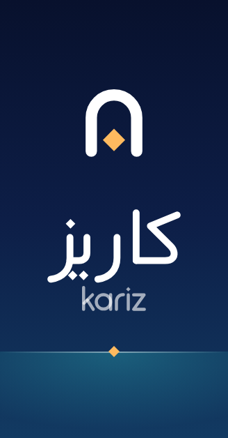
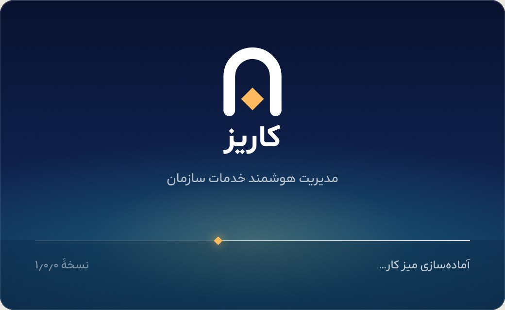

# کتاب برند «کاریز»

> **کاریز** · Kariz — مدیریت هوشمند خدمات سازمان
> سامانهٔ سازمانی مدیریت خدمات فناوری اطلاعات و خدمات سازمانی، با هوش مصنوعی؛ روی وب و ویندوز.

این سند برای همهٔ کسانی است که دربارهٔ محصول می‌نویسند، طراحی می‌کنند یا آن را می‌سازند. راهنمای فنی سامانهٔ طراحی (توکن‌ها، اجزا، ساختن صفحه) در [`DESIGN_SYSTEM.md`](DESIGN_SYSTEM.md) است و نمونهٔ زندهٔ همهٔ آنچه این‌جا آمده در خود برنامه، در **تنظیمات ← راهنمای طراحی** (`settings/style-guide`، برای مدیران تنظیمات).

| یک‌نگاه | |
|---|---|
| نام | «کاریز» · Kariz (نوشتار لاتین: kariz) |
| شعار | مدیریت هوشمند خدمات سازمان · Intelligent service management |
| نشانه | طاقِ دهانهٔ کاریز و نقطهٔ لوزی |
| رنگ‌ها | فیروزه (کنش)، لاجورد (آگاهی و هوش مصنوعی)، زعفران (گرما)، روی کاهگل و مرکب |
| حروف | آراد برای فارسی (با نقطه‌های لوزی)، «DS Num» برای رقم‌ها، Geist و Geist Mono برای لاتین و کد |
| منش | آرام، دقیق، پیوسته، گرم، امین |

---

## ۱. داستان

کاریز (قنات) راهی است که ایرانیان سه هزار سال پیش برای آوردن آب از دل زمین ساختند: کانالی زیرزمینی با شیبی اندک که آب سفره‌های دامنهٔ کوه را، بی‌پمپ و بی‌صدا، کیلومترها دورتر به شهر و کشتزار می‌رساند. از روی زمین فقط رشته‌ای از دهانهٔ چاه‌ها دیده می‌شود؛ کار اصلی پنهان است و تا وقتی درست کار می‌کند کسی آن را نمی‌بیند. «قنات ایرانی» در ۱۳۹۵ در فهرست میراث جهانی یونسکو ثبت شد.

کاریز فقط مهندسی نبود؛ نظام خدمت بود. **میراب** آب را میان کشاورزان تقسیم می‌کرد و نوبت هر کس را با **پنگان** — کاسه‌ای سوراخ‌دار که در تشتی آب فرومی‌رفت — می‌سنجید: سنجهٔ زمانی دقیق و منصفانه برای یک خدمت حیاتی. چاه‌های دسترسی برای لایروبی و نگه‌داری بود و هر خرابی را باید پیش از آن‌که آب کم شود می‌یافتند.

این، داستان مدیریت خدمات است: زیرساختی پنهان که خدمتی حیاتی را پیوسته و به‌اندازه به مردم سازمان می‌رساند؛ میز خدمتی که مثل میراب نوبت و انصاف را نگه می‌دارد؛ توافق سطح خدمتی که مثل پنگان زمان را می‌سنجد؛ نگه‌داری و تغییر که مثل لایروبی، بی‌آن‌که جریان را قطع کند انجام می‌شود؛ و هوش مصنوعی که مثل کاریز، دانش را از عمق داده‌ها به سطح می‌آورد.

**منش برند**

| | یعنی | نه |
|---|---|---|
| آرام | صفحه‌های خلوت، رنگ کم، حرکت کوتاه؛ هشدار فقط وقتی لازم است | بی‌روح یا کند |
| دقیق | عدد درست، زمان درست، واژهٔ درست؛ هر وضعیت با نام | خشک یا فنی‌نما |
| پیوسته | همیشه در دسترس، روی وب و ویندوز، با و بی اینترنت | پرسروصدا |
| گرم | زبان محترمانه و انسانی، رنگ زعفرانی در لحظه‌های خوب | خودمانی یا شوخ |
| امین | آنچه می‌گوییم همان است که هست؛ دسترسی‌ها و داده‌ها محترم | پنهان‌کار |

## ۲. نام

**کاریز** /kɒːˈriːz/ — «کا» با آ کشیده و «ریز» با ی کشیده؛ تکیه روی هجای دوم. در انگلیسی: *kah-REEZ* (هم‌قافیه با *breeze*).

- در متن فارسی: «کاریز»؛ در متن لاتین: Kariz (با K بزرگ). نوشتار لاتینِ نشانه همیشه با حروف کوچک است: kariz.
- هرگز: «کاریز ITSM»، «سامانهٔ کاریز ITSM»، KARIZ در متن، «قنات» به‌جای نام، یا ترجمهٔ نام (Qanat).
- شناسه‌های داخلی عمداً بی‌نام مانده‌اند و با تغییر نام عوض نمی‌شوند: جدول‌های `sm_*`، تنظیم‌های `itsm.*`، متغیرهای `ITSM_*`، کانال‌های `itsm:*`، `window.itsm`، کلیدهای مرورگر `itsm.*`، شناسهٔ برنامه `app.itsm.desktop`، پوشهٔ داده‌ها `%APPDATA%\ITSM` و برچسب‌های انتشار `itsm-v*`. نام فقط از `src/shared/constants.ts` (`APP_NAME`، `APP_NAME_EN`، `APP_TAGLINE`…) خوانده می‌شود؛ فایل نصب `Kariz-Setup-x.y.z.exe`، برنامهٔ نصب‌شده `Kariz.exe` و میان‌برها «Kariz» نام دارند.

### نامزدها و بررسی تداخل

بررسی تداخل با جست‌وجوی وب (آبان ۱۴۰۵) دربارهٔ نرم‌افزار، اپ و علامت تجاری ثبت‌شده انجام شد. این بررسی جای جست‌وجوی رسمی علامت تجاری را نمی‌گیرد: پیش از ثبت، نام در ادارهٔ مالکیت صنعتی ایران و پایگاه جهانی برندهای WIPO (طبقه‌های ۹ و ۴۲) جست‌وجو شود.

| نام | معنا | تلفظ (فا / en) | تناسب با ITSM، ESM و هوش مصنوعی | تداخل | نتیجه |
|---|---|---|---|---|---|
| **کاریز · Kariz** | قنات؛ کانال پنهانی که آب را پیوسته به شهر می‌رساند | کا‌ریز / *kah-REEZ* | زیرساخت پنهانِ خدمتی حیاتی، سنجهٔ منصفانه (میراب و پنگان)، دانش از عمق (هوش مصنوعی) | نرم‌افزار یا علامت تجاری شناخته‌شده‌ای نیافتیم؛ نزدیک‌ترین‌ها Karix (پیام‌رسانی سازمانی در هند، یک حرف تفاوت، حوزهٔ دیگر) و یک اپ موسیقی با نام سازنده Kariz Technologies | **برگزیده** |
| ارتا · Arta | راستی و نظم (فارسی باستان) | اَرتا / *AR-tah* | نظم و حقیقت، کوتاه و زیبا در هر دو خط | **ARTA** علامت ثبت‌شدهٔ آمریکا در طبقه‌های ۹ و ۴۲ (Arta Finance، با اپ Arta AI)؛ نزدیک به Atera، رقیب مستقیم در مدیریت فناوری اطلاعات | کنار گذاشته شد |
| نظم · Nazm | نظم؛ و «نظم» در برابر نثر یعنی شعر | نَظم / *nazm* | نظم خدمات، با لایه‌ای از شعر | تداخلی نیافتیم؛ ولی هم‌ریشه با «نظامی» و «انتظامی» و برای هوش مصنوعی بی‌پیوند | کنار گذاشته شد |
| بینا · Bina | بینا، صاحب‌بینش | بینا / *BEE-nah* | بینش و دیدپذیری (هوش مصنوعی، پایش) | bina (آموزش با هوش مصنوعی، آلمان)، Binah.ai؛ نام رایج اشخاص | کنار گذاشته شد |
| پذیرا · Pazira | پذیرا، مهمان‌نواز | پَذیرا / *pa-ZEE-rah* | میز خدمتی که هر درخواست را با گرمی می‌پذیرد | تداخلی نیافتیم؛ برای محصول سازمانی نرم و کم‌وزن | ذخیره |
| سنجه · Sanjeh | سنجه، شاخص اندازه‌گیری | سَنجه / *SAN-jeh* | توافق سطح خدمت، شاخص‌ها، دقت | تداخلی در نرم‌افزار نیافتیم؛ نزدیک به «سازمان سنجش»؛ نوشتار لاتین ناخوش‌آهنگ | کنار گذاشته شد |
| کارساز · Karsaz | کارساز، گره‌گشا | کارساز / *kar-SAHZ* | میز خدمتی که کار را راه می‌اندازد | **Karsaaz Agent** (ابزار هوش مصنوعی برای پیام صوتی)؛ صفتِ خداوند در ادب فارسی | کنار گذاشته شد |
| دیدبان · Didban | دیده‌بان | دیدبان / *DEED-bahn* | پایش و رویداد | خبرگزاری «دیدبان ایران»؛ بار معنایی نظارت و مراقبت از مردم | کنار گذاشته شد |

رد در همان گام نخست: سامان (بانک سامان)، پایا (سامانهٔ پایای بانک مرکزی و Paya در آمریکا)، آوند (نزدیک به Avanade، شرکت خدمات فناوری)، یارا (قواعد YARA در ابزارهای امنیتی)، رسا (چارچوب هوش مصنوعی Rasa)، سروش (پیام‌رسان)، آگاه (کارگزاری)، میزان (خبرگزاری قوهٔ قضاییه).

**چرا کاریز:** کوتاه است (دو هجا) و در هر دو خط پاکیزه خوانده می‌شود؛ ریشه در مهندسی و فرهنگ ایرانی دارد بی‌آن‌که شعاری یا تزئینی باشد؛ داستانی دارد که هم ITSM (خدمت پیوسته، سنجهٔ زمان، نگه‌داری)، هم مدیریت خدمات سازمانی (رساندن خدمت به همهٔ سازمان) و هم هوش مصنوعی (آوردن دانش از عمق) را در خود دارد؛ و تداخلی با نرم‌افزارهای شناخته‌شده نیافتیم.

## ۳. نشانه

**نشانه** طاقِ دهانهٔ کاریز است — جایی که آبی که زیر بیابان راه آمده به روشنایی می‌رسد (مَظهَر) — و **نقطهٔ لوزی**، واحد اندازه در خوشنویسی، که مثل قطرهٔ آب در دهانهٔ طاق نشسته است. طاق، درگاه خدمت است و نقطه، دقت و سنجه. نشانه روی همان شبکهٔ ۲۴ واحدی نمادهای برنامه با یک خط ۲٫۸ واحدی و سرهای گرد کشیده شده و یک برش سنگین‌تر برای ۲۴ پیکسل و کمتر دارد.

**نوشتارها** دست‌کشیده‌اند، تک‌خط و با سرهای گرد، هم‌خانوادهٔ نشانه: «کاریز» بر استخوان‌بندی قلم آراد (کاف با سرکش جدا، سه نقطهٔ لوزی) و «kariz» هندسی، با نقطهٔ i به شکل همان نقطهٔ لوزی.

| جزء | فایل‌ها (`docs/brand/logo/`) |
|---|---|
| نشانه | `kariz-mark.svg` |
| نوشتار فارسی و لاتین | `kariz-wordmark-fa.svg`، `kariz-wordmark-en.svg` |
| قفل افقی (نشانه در آغاز جهت خواندن) | `kariz-lockup-fa.svg` (نشانه در راست)، `kariz-lockup-en.svg` (نشانه در چپ) |
| قفل عمودی (نشانه، فارسی، لاتین) | `kariz-lockup-stacked.svg` |
| نسخه‌ها | هر فایل با پسوند `-dark` (روی زمینهٔ تیره)، `-mono` (تک‌رنگ مرکب)، `-inverse` (سفید) |
| نماد برنامه | `kariz-app-icon.svg` (کاشی گرد)، `kariz-app-icon-square.svg` (تمام‌قاب برای نمادهای maskable) |

**رنگ نشانه:** طاق فیروزه‌ای (`#0A7178` روی روشن، `#61C6CF` روی تیره) و نقطه زعفرانی (`#C8830B` / `#EEA023`)؛ روی شب برند و کاشی برنامه، طاق سفید و نقطه زعفرانی روشن (`#FEBA5F`). تک‌رنگ برای چاپ، مُهر و حکاکی؛ سفید روی عکس و زمینه‌های رنگی.

**حریم:** دور نشانه و قفل‌ها دست‌کم به پهنای دهانهٔ طاق (نیمِ پهنای نشانه) خالی بماند.
**کوچک‌ترین اندازه:** نشانه ۱۶ پیکسل (۵ میلی‌متر)؛ قفل افقی ۷۲ پیکسل پهنا (۲۰ میلی‌متر)؛ قفل عمودی ۴۸ پیکسل.

| درست | نادرست |
|---|---|
| نشانه در آغاز جهت خواندن: راستِ «کاریز»، چپِ «kariz» | جابه‌جا کردن نشانه و نام یا گذاشتن نام زیر قفل افقی |
| رنگ‌های بالا، تک‌رنگ یا سفید | گرادیان، سایه، خط دور، رنگ دیگر، نقطهٔ قرمز |
| فایل‌های اصلی یا اجزای `brand.tsx` | بازنویسی نام با قلم دیگر کنار نشانه |
| نسبت‌ها همان‌طور که هست | کشیدن، چرخاندن، بریدن، فشردن |
| کاشی گرادیانی فقط برای نماد برنامه | کاشی پشت نشانه در صفحه‌ها و سربرگ‌ها |

**دارایی‌ها:** همه از یک طرح (`src/shared/brand.ts`) ساخته می‌شوند: `npm run brand` (یا `cd desktop && npm run icons`) نمادهای وب (`favicon.svg/.ico`، `apple-touch-icon.png`، نمادهای PWA و maskable)، نماد ویندوز `icon.ico` (۱۶ تا ۲۵۶ پیکسل)، نماد سینی، تصویرهای نصب‌کننده (`installerSidebar.bmp` ۱۶۴ × ۳۱۴ و `installerHeader.bmp` ۱۵۰ × ۵۷) و پیش‌نمایش‌های این پوشه را می‌سازد.

| نماد برنامه | نصب‌کننده | صفحهٔ آغاز ویندوز |
|---|---|---|
|  |   |  |

**صفحهٔ آغاز** (`desktop/src/splash.html`، ۵۲۰ × ۳۲۰، تا وقتی سرور محلی بالا بیاید): شب کاریز، طاقی که خود را می‌کشد، نقطه‌ای که در دهانه می‌نشیند، نام و شعار؛ افق همان نوار پیشرفت است و سرِ آن نقطه‌ای زعفرانی که روی افق پیش می‌رود و در پایان فیروزه‌ای می‌شود — «آب رسید».

## ۴. رنگ

۹۰ تا ۹۵ درصد هر صفحه خنثی است: **کاهگل و مرکب** در پوستهٔ روشن (کاغذ گرم و جوهر) و **شب کویر** در پوستهٔ تیره (زغال گرم، هرگز سرمه‌ای). رنگ‌های برند کم و با معنا به کار می‌روند.

| رنگ | نقش | ۵۰ | ۲۰۰ | ۴۰۰ | ۶۰۰ | ۷۰۰ | ۹۰۰ |
|---|---|---|---|---|---|---|---|
| **فیروزه** | کنش اصلی، تمرکز، انتخاب، سری اصلی نمودار، «در جریان» | `#EEF9FA` | `#BFEBEF` | `#61C6CF` | `#0C959E` | `#0A7178` | `#044348` |
| **لاجورد** | آگاهی، «جدید»، هوش مصنوعی، یادداشت داخلی، شب برند | `#F2F5FE` | `#C8D7FE` | `#7C9AEF` | `#3D5BC6` | `#2E47A9` | `#16255C` |
| **زعفران** | گرما، نقطهٔ نشانه، «در انتظار»، جشن | `#FEF5EB` | `#FED4A2` | `#EEA023` | `#A66C08` | `#875806` | `#4E3104` |

- **یک کنش فیروزه‌ای در هر بخش.** پیوندها مرکب‌اند با خط زیرین؛ چک‌باکس و سوئیچ مرکب.
- **معنایی:** موفق سبز `#1B7248`، هشدار نارنجی `#A35612` (روی سطح، هرگز زمینهٔ کهربایی)، خطا قرمز انار `#B63731`، آگاهی لاجورد `#2E47A9`. رنگ هرگز تنها نشانه نیست: هر وضعیت واژه و نقطه دارد.
- **وضعیت رکورد:** جدید (لاجورد)، در جریان (فیروزه)، در انتظار (زعفران)، حل‌شده (سبز)، بسته (مرکب)، لغوشده (مرکب، نقطهٔ توخالی).
- **اولویت:** P1 بحرانی (انار)، P2 زیاد (نارنجی)، P3 متوسط (زعفران)، P4 کم (لاجورد)، P5 برنامه‌ریزی (خنثی).
- **توافق سطح خدمت:** در مهلت (سبز)، نزدیک به نقض از ۷۵٪ (نارنجی)، نقض‌شده (انار)، متوقف (خنثی)، انجام در مهلت (سبز).
- **نمودار:** هشت رنگ با ترتیب ثابت — فیروزه، زعفران، شامگاه، سفال، لاجورد، پسته، گردو، آسمان — که همسایه‌هایشان برای کوررنگی سنجیده شده‌اند؛ بیش از هشت سری در «سایر» جمع می‌شود. طیف پیوسته فیروزه‌ای و واگرا لاجورد ↔ خاکستری ↔ سفال.
- **کنتراست:** همهٔ جفت‌های متن و زمینه در هر دو پوسته دست‌کم AA (۴٫۵:۱) و نشانه‌ها و لبه‌ها دست‌کم ۳:۱ — ۵۴۲ جفت با `scripts/ds-tokens.ts` و در آزمون‌ها سنجیده می‌شوند.

## ۵. حروف

| کاربرد | قلم | مجوز |
|---|---|---|
| همهٔ متن فارسی (رابط، عنوان‌ها، صفحهٔ آغاز) | **آراد** (Arad، متغیر، محور DSTY ۳ برای نقطه‌های لوزی) | SIL OFL 1.1، نام محفوظ «Arad» |
| همهٔ رقم‌ها (جدول‌ها، تاریخ‌ها، شاخص‌ها) | **DS Num** (زیرمجموعهٔ رقمیِ وزیرمتن) | SIL OFL 1.1 |
| واژه‌ها و نام لاتین | **Geist** | SIL OFL 1.1 |
| کد، نشانی، شناسهٔ فنی | **Geist Mono** | SIL OFL 1.1 |

وزیرمتن در پروژه هست و رقم‌هایش را نگه داشتیم؛ ولی متن را با آراد می‌نویسیم، چون نقطه‌های لوزیِ آن (DSTY ۳) همان نقطهٔ خوشنویسانهٔ نشانه است و در اندازه‌های کوچک رابط، روشن و آرام خوانده می‌شود. همهٔ قلم‌ها از پوشهٔ خود برنامه (`src/ui/static/fonts/ds`) بار می‌شوند؛ بی‌اینترنت و بدون CDN.

مقیاس (اندازه / ارتفاع سطر / وزن): نمایش ۴۸/۶۰/۷۶۰ · عنوان صفحه ۲۶/۳۶/۷۰۰ · بخش ۱۸/۲۸/۷۰۰ · عنوان کارت ۱۶/۲۴/۶۰۰ · متن ۱۴/۲۲/۴۵۰ · جدول فشرده ۱۳/۲۰/۴۵۰ · برچسب ۱۳/۲۰/۵۴۰ · زیرنویس ۱۲/۱۸/۴۸۰ · بند بلند ۱۴/۲۶/۴۵۰. سه وزن رابط: ۴۵۰، ۵۴۰ و ۶۰۰. متن فارسی هرگز کوچک‌تر از ۱۲ پیکسل.

**رقم‌ها** پیش‌فرض فارسی‌اند (۱۲۳٬۴۵۶٫۷۸) و در ستون‌ها هم‌عرض. شناسه‌هایی که باید لاتین بمانند (`INC-000123` در خروجی، شمارهٔ سریال) با `.ds-id` و کد و نشانی (`10.0.4.17`) با `.ds-mono` می‌آیند؛ هر تکهٔ چپ‌به‌راست یک جزیرهٔ دوسویه است. تاریخ‌ها خورشیدی.

## ۶. حرکت

حرکت فقط برای فهمیدن است: از کجا آمد، کجا رفت، چه تغییر کرد. کوتاه (۱۰۰ تا ۲۴۰ میلی‌ثانیه)، با منحنی «بیرون‌رو»، فقط با جابه‌جایی و شفافیت؛ هرگز `transition: all` و هرگز حلقه — جز نقطهٔ هم‌گام‌سازی.

- **ریزتعامل‌ها:** اشاره فوری ظاهر و آرام محو می‌شود؛ دکمه زیر انگشت ۲٪ کوچک می‌شود؛ تمرکز حلقهٔ فیروزه‌ای ۲ پیکسلی با فاصلهٔ ۲ پیکسل.
- **گذارها:** برگهٔ کناری از لبهٔ پایان (چپ) در ۲۴۰ میلی‌ثانیه می‌آید و در ۱۸۰ می‌رود؛ گفت‌وگو از ۹۶٪ بزرگ می‌شود؛ صفحه با محو و ۸ پیکسل بالا آمدن.
- **بارگذاری:** اسکلت در نخستین بار (پس از ۲۰۰ میلی‌ثانیه)، سه نقطهٔ لوزی برای انتظار بیش از یک ثانیه؛ هرگز چرخنده در محتوا.
- **به‌روزرسانی خوش‌بینانه:** تغییر فوراً دیده می‌شود، تا تأیید سرور کم‌رنگ است و پس از تأیید یک درخشش کوتاه؛ اگر شکست خورد برمی‌گردد و پیامی می‌گوید چرا.
- **جشن:** برای نقطه‌های عطف (رخداد عمده حل شد، تغییر بی‌رخداد بسته شد) چند نقطهٔ فیروزه‌ای، زعفرانی و لاجوردی یک‌بار از جای کار برمی‌خیزند و محو می‌شوند؛ هرگز برای ذخیرهٔ روزمره.
- **کاهش حرکت:** با تنظیم سیستم یا حالت کم‌مصرف ویندوز، همهٔ جابه‌جایی‌ها حذف و فقط محوشدن کوتاه می‌ماند؛ جشن به حلقه‌ای آرام بدل می‌شود.

## ۷. نماد و تصویر

**نمادها:** فقط Lucide، ۱۶ پیکسل، خط ۱٫۴ در هر اندازه، رنگ از متن (نه رنگ تأکید). در راست‌به‌چپ **فقط نمادهای جهت‌دار** برمی‌گردند — پیکان‌ها، شِورون‌ها، بازگشت و پیش، واگرد و از نو، پاسخ، فرستادن، تورفتگی، ورود و خروج، پیوند بیرونی؛ ساعت و تاریخچه، تیک، ذره‌بین، پخش، نمودار و روند، نشان‌ها و اشیا هرگز برنمی‌گردند. نشان هوش مصنوعی همان تراشهٔ «AI» است و «جرقهٔ نقطه» برای پیشنهادها.

**تصویرها:** هفت تصویر خطی برای حالت‌های خالی صفحه و نخستین اجرا — خالی، بی‌نتیجه، همه انجام شد، بی‌اتصال، بی‌دسترسی، خطا، خوش‌آمد — روی نقش‌مایه‌های برند (طاق، افق، آب فیروزه‌ای، نقطهٔ زعفرانی) و با رنگ‌های پوسته. در جدول‌ها و فهرست‌ها کاشی نماد کافی است.

## ۸. لحن و زبان

ما مثل همکاری کاردان حرف می‌زنیم که کار را بلد است و وقت دیگران را محترم می‌شمارد: **روشن، کوتاه، محترمانه، بی‌اغراق.**

1. **«شما»**، فعل معلوم و جملهٔ کوتاه. «درخواست شما ثبت شد» نه «درخواست توسط سیستم با موفقیت ثبت گردید».
2. **کار را بگوییم، نه سیستم را.** «رخداد به گروه پشتیبانی شبکه سپرده شد» نه «تخصیص انجام شد».
3. **خطا = چه شد + چه کنید.** «ذخیره نشد: اتصال برقرار نیست. دوباره تلاش کنید؛ تغییرات شما روی همین دستگاه مانده است.» هرگز کاربر را مقصر ندانیم و کد خطا را تنها پیام نکنیم.
4. **بی‌علامت تعجب، بی‌اغراق.** نه «عالی!» و «فوق‌العاده»؛ جشن را تصویر می‌گوید، نه متن.
5. **دکمه با فعل:** «ثبت رخداد»، «تأیید تغییر»، «ارسال پاسخ»؛ نه «تأیید» و «OK» وقتی کار مشخص است.
6. **واژگان یکسان:** رخداد، مشکل، تغییر، درخواست، دانش، دارایی، توافق سطح خدمت (موعد توافق)، کارشناس، درخواست‌دهنده، گروه پشتیبانی، اولویت، وضعیت. «حادثه»، «تیکت» و «اینسیدنت» به کار نمی‌روند.
7. **نگارش:** نیم‌فاصله در «می‌شود»، «درخواست‌دهنده»، «رخدادها»؛ ویرگول فارسی «،» و پرسش‌نمای «؟»؛ گیومهٔ «» برای نام‌ها؛ سه‌نقطهٔ «…» برای کار در جریان («در حال ذخیره…»)؛ رقم فارسی و تاریخ خورشیدی؛ واحد پس از عدد با فاصله («۴ ساعت»).
8. **توضیح‌ها در «راهنما»،** نه روی صفحه‌ها؛ هر صفحه با عنوانی کوتاه و حداکثر یک جملهٔ کمکی.

| به‌جای | بنویسید |
|---|---|
| عملیات با موفقیت انجام شد! | تغییر ذخیره شد. |
| خطای ۵۰۰ رخ داد | ذخیره نشد: سرور پاسخ نداد. چند لحظهٔ دیگر دوباره تلاش کنید. |
| شما مجوز ندارید | به این بخش دسترسی ندارید؛ از مدیر سازمان بخواهید. |
| آیا مطمئن هستید؟ | این رخداد و ۳ کار وابسته‌اش حذف شوند؟ |
| تیکت جدید | رخداد تازه |

## ۹. درست و نادرست

| درست | نادرست |
|---|---|
| یک کنش اصلی فیروزه‌ای در هر بخش | چند دکمهٔ رنگی کنار هم |
| وضعیت با واژه + نقطه + رنگ | رنگ تنها، یا نقطهٔ قرمز برای هر چیز |
| هشدار روی سطح با نقطهٔ نارنجی | زمینهٔ زرد و کهربایی |
| رقم فارسی، هم‌عرض در جدول؛ هرگز بریده با «…» | رقم لاتین در متن فارسی، عدد بریده |
| حرکت کوتاه و فقط برای فهم | انیمیشن تزئینی، حلقه، جهش |
| تصویر خطی در صفحهٔ خالی | تصویر در میان جدول‌ها، یا آدمک و کارتون |
| نقش‌مایهٔ ایرانی کم و انتزاعی (طاق، نقطه) | کاشی‌کاری، اسلیمی و بته‌جقه به‌عنوان تزئین |

## ۱۰. پرونده‌ها و ابزار

| چه | کجا |
|---|---|
| نام و شعار | `src/shared/constants.ts` |
| طرح نشانه و نوشتارها | `src/shared/brand.ts` → `src/ui/components/brand.tsx` |
| ساخت همهٔ دارایی‌ها | `npm run brand` (`scripts/brand-assets.mts`) |
| توکن‌ها و پوسته‌ها | `src/ui/ds/tokens.css` (+ `ds-palette.ts` با `npm run tokens`) |
| سنجش کنتراست و نمودار | `npx tsx scripts/ds-tokens.ts` و `tests/design-system.test.ts` |
| راهنمای زنده | برنامه ← تنظیمات ← راهنمای طراحی |
| راهنمای فنی | [`docs/DESIGN_SYSTEM.md`](DESIGN_SYSTEM.md) |
| پیش و پس | [`docs/brand/screens/`](brand/screens/) |
| نسخهٔ نهایی (همهٔ بخش‌ها، نسخهٔ سرور و ورود سازمانی) | [`docs/brand/final/`](brand/final/) |

## ۱۱. پیش و پس

شش صفحهٔ کلیدی — ورود، خانه، صف رخدادها، صفحهٔ رکورد، داشبورد رخدادها و درگاه — در روشن، تیره و گوشی، پیش و پس از برند (`docs/brand/screens/before-*` و `after-*`). در «پیش»، ترتیب لایه‌های CSS به‌هم ریخته بود و بیشتر سبک‌های سامانهٔ طراحی اعمال نمی‌شد؛ «پس» همان صفحه‌هاست با ترتیب درست لایه‌ها و برند کاریز. بازطراحی صفحه‌ها گام بعد است.

نسخهٔ نهایی — پس از ادغام برند با ورود سازمانی و ویندوز، «امنیت ورود و نشست‌ها»، نسخهٔ سرور (راه‌اندازی نخست و «سلامت سرور»)، خدمات میدانی، سطح خدمت، نیروی کار و مرکز اتصال‌ها — در [`docs/brand/final/`](brand/final/) است (`node scripts/ui-shots.mjs` و `node scripts/ui-shots-mocked.mjs`).
