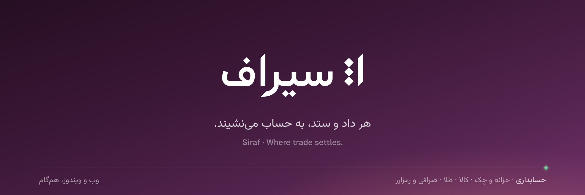

<p align="center">
  
</p>

<p align="center">
  <b>حسابداری و مدیریت کسب‌وکار</b> · کالا، طلا، ارز — یک دفتر.<br />
  <sub>نسخهٔ وب (Vercel + Supabase) و برنامهٔ ویندوز (بی‌اینترنت، با یک فایل نصب)، هم‌گام با هم.</sub>
</p>

<p align="center">
  <a href="https://github.com/tahahajiaghajani/ai/releases"><b>دریافت برای ویندوز</b></a>
  &nbsp;·&nbsp; <a href="docs/SETUP_FA.md">راه‌اندازی</a>
  &nbsp;·&nbsp; <a href="docs/DESKTOP_FA.md">نسخهٔ ویندوز</a>
  &nbsp;·&nbsp; <a href="docs/ARCHITECTURE_FA.md">معماری</a>
  &nbsp;·&nbsp; <a href="docs/BRAND_FA.md">برند</a>
</p>

---

**سیراف** نرم‌افزار حسابداری و مدیریت کسب‌وکارِ کاملاً فارسی و راست‌چین است: یک دفتر کل برای همهٔ داد و ستدها، و ماژول‌هایی که هر کسب‌وکار به اندازهٔ نیازش روشن می‌کند — **کالا و بازرگانی**، **طلا و جواهر**، **صرافی نقدی و دیجیتال**، و **خزانه و چک**. همان برنامه روی وب و روی ویندوز اجرا می‌شود و دو طرف خودکار هم‌گام می‌مانند.

> هزار سال پیش، سیراف در کرانهٔ خلیج فارس بندرِ پررونقِ داد و ستد با چین و هند و آفریقا بود؛ کالا و زر و سکه‌های گوناگون در بندرش دست‌به‌دست می‌شد و حسابِ هر بازرگان باید آن سوی دریا هم اعتبار می‌داشت. سیرافِ امروز همان بندر است برای کسب‌وکار شما. ([داستان نام و نشان](docs/BRAND_FA.md))

## قابلیت‌ها

<table>
<tr><td width="50%" valign="top">

**حسابداری** — همیشه روشن
- کدینگ گروه/کل/معین و تفصیلی شناور (اشخاص، صندوق، بانک، کیف‌پول، مرکز هزینه، پروژه) با الگوی آماده برای هر نوع کسب‌وکار
- ویرایشگر سند صفحه‌کلیدمحور (<kbd>Enter</kbd>، <kbd>=</kbd> برای مبلغ تراز‌کننده، <kbd>+</kbd> برای سه صفر، <kbd>F2</kbd> ثبت)، پیش‌نویس/ثبت/قطعی و اسناد خودکار از همهٔ ماژول‌ها
- **دفتر کل سه‌بعدی**: هر ردیف مبلغ ریالی، مبلغ ارزی با نرخ و وزن طلا (گرم ۷۵۰) دارد
- تراز آزمایشی ۴/۶/۸ ستونی، دفاتر کل و معین و تفصیلی، روزنامه، سود و زیان، ترازنامه، خروجی اکسل و چاپ
- سال مالی، بستن حساب‌های موقت، اختتامیه و افتتاحیهٔ خودکار

</td><td width="50%" valign="top">

**خزانه و چک**
- صندوق، بانک و کارتخوان؛ دریافت و پرداخت با چند ابزار هم‌زمان؛ انتقال وجه
- چک دریافتی و پرداختی با شناسهٔ صیادی و چرخهٔ کامل (واگذاری، وصول، برگشت، خرج، عودت، پاس) با سند خودکار هر مرحله

**کالا و بازرگانی**
- کالا و خدمات با واحد فرعی و بارکد، چند انبار، فاکتور خرید و فروش و برگشت، پیش‌فاکتور، فهرست قیمت
- ارزش افزوده، اسناد انبار، انبارگردانی، **میانگین موزون متحرک** با محاسبهٔ دوباره پس از اسناد عقب‌تاریخ، کاردکس، گزارش فروش و سود

</td></tr>
<tr><td valign="top">

**طلا و جواهر**
- تابلوی قیمت (مظنه، گرم ۱۸، سکه، انس) دستی یا زنده؛ اتیکت بارکددار با وزن، عیار، اجرت و سود
- فروش سریع با اسکن اتیکت و فرمول قانونی (مالیات فقط روی اجرت و سود)، تعویض طلای کهنه، خرید از همکار، امانی، کارگاه، ذوب و ری‌گیری
- **حساب وزنی اشخاص** و گزارش موجودی وزنی

</td><td valign="top">

**صرافی و رمزارز**
- تابلوی نرخ خرید و فروش با **قیمت زنده** (KuCoin، OKX، CoinGecko، نوبیتکس، منبع سفارشی)
- خرید، فروش و تبدیل هر جفت‌ارز با میانگین بها و سود محقق‌شده؛ احراز هویت مشتری؛ **حوالهٔ** صادره و وارده
- **کیف‌پول‌های رمزارز با موجودی زنده از بلاک‌چین** (بیت‌کوین، اتریوم و ERC20، BSC، ترون و USDT-TRC20، سولانا، TON و …)، موقعیت ارزی و تسعیر

</td></tr>
<tr><td valign="top">

**سازمان و اتصال‌ها**
- چند کسب‌وکار در هر حساب، نقش‌ها (مالک، مدیر، حسابدار، فروشنده، صندوقدار، انباردار، ناظر) و دسترسی هر بخش، گزارش رویدادها
- Webhook امضاشده برای **ووکامرس** و **شاپیفای**، **API کلیددار**، ورود از اکسل/CSV در همهٔ فهرست‌ها
- جستجوی سراسری <kbd>Ctrl</kbd> <kbd>K</kbd>، تقویم شمسی، تم روشن و تیره، صفحهٔ مدیریت سامانه

</td><td valign="top">

**برنامهٔ ویندوز**
- یک فایل نصب فارسی (`Siraf-Setup-x.y.z.exe`) با PostgreSQL داخلی؛ هیچ نصب جداگانه‌ای لازم نیست
- کار کامل بی‌اینترنت و هم‌گامی خودکار با نسخهٔ وب
- **حالت شبکه** برای چند رایانه و گوشی در یک فروشگاه، پشتیبان خودکار و بازگردانی، چاپ و PDF

</td></tr>
</table>

## راهنماها

| | |
|---|---|
| راه‌اندازی: Supabase، Vercel و فایل نصب | [`docs/SETUP_FA.md`](docs/SETUP_FA.md) |
| نسخهٔ ویندوز: نصب، شبکهٔ فروشگاه، پشتیبان | [`docs/DESKTOP_FA.md`](docs/DESKTOP_FA.md) |
| معماری و همگام‌سازی | [`docs/ARCHITECTURE_FA.md`](docs/ARCHITECTURE_FA.md) |
| نام، نشان، رنگ‌ها و قلم‌ها | [`docs/BRAND_FA.md`](docs/BRAND_FA.md) |
| پایگاه دادهٔ کامل برای Supabase | [`supabase/schema.sql`](supabase/schema.sql) |
| تحقیق: نرم‌افزارهای کالا، طلا و صرافی | [`docs/RESEARCH_FA.md`](docs/RESEARCH_FA.md) |
| فایل نصب ویندوز | صفحهٔ [**Releases**](https://github.com/tahahajiaghajani/ai/releases): `siraf-vX.Y.Z` (شاخهٔ `main`) یا `siraf-preview` (پیش‌نمایش) ← `Siraf-Setup-x.y.z.exe` |

## ساختار

```
siraf/
├─ src/shared     منطق مشترک: مبالغ دقیق، تقویم شمسی، فرمول‌های طلا، اعتبارسنجی، تعریف داده‌ها، دسترسی‌ها
├─ src/server     API (Hono): احراز هویت، حسابداری، ماژول‌ها، همگام‌سازی، اتصال‌ها، migrationها
├─ src/ui         رابط کاربری (React 19 + Ant Design 6 + Tailwind 4، Vite) و سامانهٔ طراحی (src/ui/siraf)
├─ src/desktop    سرور محلی نسخهٔ ویندوز (PGlite)، همگام‌سازی با ابر، پشتیبان‌گیری
├─ app/api        میزبانی API روی Vercel (Next.js)
├─ desktop        Electron، صفحهٔ آغاز و فایل نصب NSIS
├─ supabase       schema.sql و migrationها (خودکار ساخته می‌شوند)
├─ tests          آزمون‌ها (هسته، ماژول‌ها، همگام‌سازی دوطرفه، PostgreSQL واقعی)
└─ docs           راهنماها، برند و تحقیق
```

## فرمان‌ها

```bash
npm ci
npm run typecheck && npm test && npm run build   # build بدون هیچ متغیر محیطی
npm run build:ui && npm run start:local          # نسخهٔ «ویندوزی» بدون Electron روی :3939
npm run schema                                   # به‌روزرسانی supabase/schema.sql
node scripts/ui-shots.mjs --port 4102            # عکس صفحه‌ها در تم روشن و تیره و گوشی، با گزارش خطا
node scripts/build-desktop.mjs && (cd desktop && npm ci && npx electron-builder --win)   # فایل نصب
```

<p align="center"><sub>سیراف · Siraf — Where trade settles.</sub></p>
