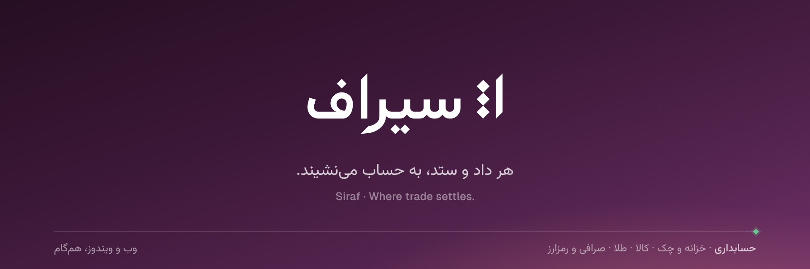
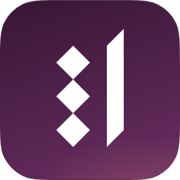
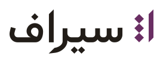
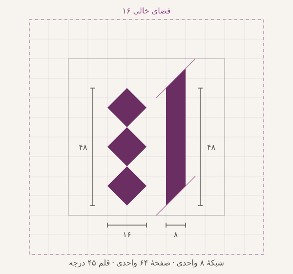
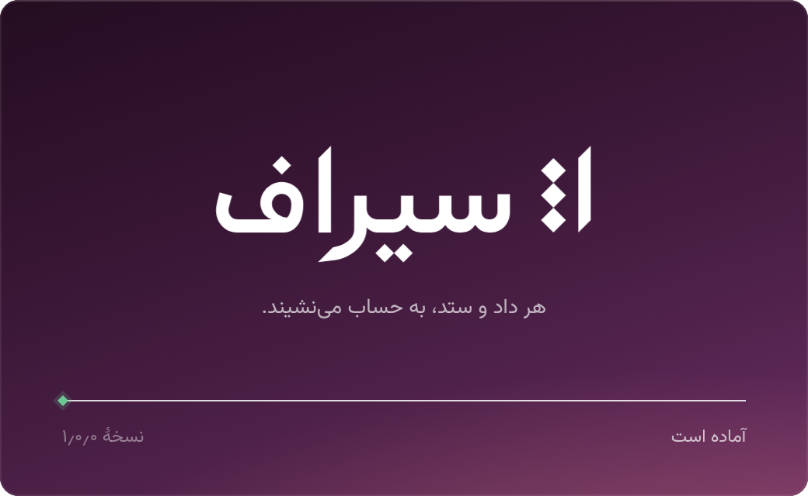

# برند «سیراف»

این سند خلاصهٔ برند سیراف است: نام و داستانش، نشان و ساختارش، رنگ‌ها، قلم‌ها و مجوزشان، و قاعده‌های به‌کاربردن آن‌ها. مقدارهای دقیق در کد است و این سند به آن‌ها اشاره می‌کند:

| چه | کجا |
|---|---|
| توکن‌ها (رنگ، اندازه، فاصله، سایه، حرکت) — منبع حقیقت | `src/ui/siraf/tokens.css` (`--sf-*`) |
| تم Ant Design و راهنمای بازسازی صفحه‌ها | `src/ui/siraf/siraf-theme.ts`، [`src/ui/siraf/README.md`](../src/ui/siraf/README.md) |
| نشان و نام‌واره در رابط کاربری | `src/ui/components/brand.tsx` (`SirafMark`، `Wordmark`، `Logo`، `SirafTile`) |
| نام، شعار و توصیف | `src/shared/constants.ts` (`APP_NAME`، `APP_NAME_EN`، `APP_TAGLINE`، `APP_TAGLINE_EN`، `APP_DESCRIPTION`) |
| قلم‌ها و متن مجوزشان | `src/ui/static/fonts/siraf/` |
| نشان و قفل‌شده‌ها (SVG) | [`docs/brand/`](brand/) |
| آیکون ویندوز، Tray و تصویرهای نصب‌کننده | `desktop/build/` |
| صفحهٔ آغاز ویندوز | `desktop/src/splash.html` |

---

## ۱. نام

**سیراف · Siraf** (شناسه: `siraf`). تا آبان ۱۴۰۵ نام برنامه «تراز» بود.

سیراف بندر بزرگ ایرانی خلیج فارس در سده‌های ساسانی و آغاز اسلامی بود و اوجش حدود سال‌های ۸۰۰ تا ۱۰۵۰ میلادی. کشتی‌ها از چین و هند و شرق آفریقا می‌رسیدند و ابریشم و چینی، مروارید و ادویه، زر و سکه‌های گوناگون در بندرش دست‌به‌دست می‌شد. ابوزید سیرافی گزارش‌های بازرگانان و دریانوردان از چین و هند را گرد آورد و رامشت سیرافی تا چین تجارت می‌کرد.

> هزار سال پیش، سیراف در کرانهٔ خلیج فارس بندرِ پررونقِ داد و ستد با چین و هند و آفریقا بود. ابریشم و چینی، مروارید و ادویه، زر و سکه‌های گوناگون در بندرش دست‌به‌دست می‌شد و حرف و حسابِ هر بازرگان باید آن سوی دریا هم اعتبار می‌داشت. سیرافِ امروز همان بندر است برای کسب‌وکار شما: کالا، طلا، نقد و چک، حواله و رمزارز به یک‌جا می‌رسند، دقیق سنجیده و نوشته می‌شوند و در یک دفتر می‌نشینند — روی وب و ویندوز، با اینترنت و بی‌اینترنت.

**چرا سیراف:**
- **خود محصول است در یک واژه.** بندر جایی است که کالا، طلا و ارز می‌رسند، سنجیده و نوشته و تسویه می‌شوند؛ هیچ ماژولی بر دیگری برتری ندارد.
- **اصطلاح حسابداری نیست.** «تراز» با «تراز آزمایشی» در منوی خود برنامه برخورد می‌کرد؛ سیراف با هیچ گزینه‌ای از منو یکی نیست و پسوندهای تکراری بازار (‑سیستم، ‑سافت، ‑پی) یا ریشهٔ زر و طلا را ندارد.
- **آشنا ولی بی‌صاحب.** بیشتر ایرانی‌ها بندر سیراف را از کتاب درسی می‌شناسند و هیچ نرم‌افزاری آن را ندارد.
- **خوش‌آوا و خوش‌نوشت.** دو هجا (سی‑راف) و هم‌قافیه با «صرّاف»؛ در نام‌واره، الفِ بلند وسط «سیراف» ستون واژه است و نشان از همان ساخته شده.
- **لاتینش هم سفر می‌کند.** "Siraf" پنج حرف است و در زبان‌های همسایه معنای بدی ندارد.

**پیش از عرضهٔ عمومی:** جست‌وجوی علامت تجاری در مرکز مالکیت معنوی (طبقه‌های ۹، ۳۵، ۳۶ و ۴۲)، جست‌وجوی نام در بازار و مایکت، و ثبت دامنهٔ `siraf.app` و یک دامنهٔ `.ir`.

**نوشتن نام:**
- همیشه اول فارسی: «سیراف». در متن لاتین "Siraf" (نه SIRAF).
- عنوان پنجره: «سیراف — {صفحه}». ماژول‌ها در برنامه فقط «طلا»، «صرافی» و …اند؛ «سیراف · طلا» فقط در تبلیغ.
- در کد نام را هرگز دستی ننویسید؛ از `APP_NAME` استفاده کنید.
- «تراز» فقط در معنای حسابداری‌اش می‌ماند: تراز آزمایشی، ترازنامه، تراز افتتاحیه، «سند تراز است».

## ۲. شعار، شخصیت و لحن

**شعار:** «هر داد و ستد، به حساب می‌نشیند.» · *Where trade settles.*

«به حساب نشستن» همان جملهٔ هر روزهٔ «واریزی نشست؟» است؛ «نشستن» هم پهلو گرفتن کشتی است و هم فرو رفتن خورشید. پس یک فعل، بندر و دفتر و رنگ برند (شامگاه) را با هم می‌گوید. جمله‌های کمکی (هر بار فقط یکی): «کالا، طلا، ارز — یک دفتر.» و «حسابِ روشن، داد و ستدِ آسوده.»

| شخصیت | در محصول یعنی |
|---|---|
| **دقیق** | هر ریال، گرم و نرخ درست است و درست دیده می‌شود: رقم‌های جدولی، منهای واقعی، گرد کردن درست، تاریخ شمسی. |
| **آرام** | سطح‌های ساکت؛ رنگ فقط جایی که معنا دارد و حرکت فقط جایی که چیزی را توضیح می‌دهد. |
| **امین** | کارش را نشان می‌دهد: وضعیت هم‌گامی و پشتیبان، گزارش رویدادها، چه کسی چه چیزی را کی عوض کرد. |
| **جهان‌دیده** | با ریال و تومان، درهم و دلار، USDT، گرم و مثقال و حواله راحت است. |
| **پرداخته** | نیم‌فاصله، جداکننده‌های فارسی، کلیدهای میان‌بر زیبا؛ هیچ چیز به حال خود رها نشده. |

**لحن:** جمله‌های کوتاه، اصطلاح دقیق حسابداری، عدد پیش از صفت. **هرگز** علامت تعجب، صفت عالی («کامل‌ترین»، «رتبهٔ یک»)، شمارندهٔ کاربر یا «سوپراپلیکیشن». نیم‌فاصله همه‌جا، «ی» و «ک» فارسی، گیومهٔ «»، ٪ و جداکننده‌های ٬ و ٫، و برای هر مفهوم یک واژه (سند همیشه سند است).

| موقعیت | بنویسید | ننویسید |
|---|---|---|
| ثبت | «سند ۱۲۴ ثبت شد.» | «با موفقیت ثبت شد!» |
| ناتراز | «اختلاف ۲۰۰٬۰۰۰ ریال؛ بدهکار بیشتر است.» | «خطا: سند تراز نیست!» |
| بی‌اینترنت | «بی‌اینترنت کار می‌کنید. ۳ تغییر پس از اتصال فرستاده می‌شود.» | «اتصال قطع است!» |
| خالی | «هنوز چکی ثبت نشده.» + یک دکمهٔ «ثبت چک دریافتی» | توضیح چندخطی |

## ۳. نشان: «اندازه»، الفِ سنجیده

  
  &nbsp;&nbsp;&nbsp;
  
  &nbsp;&nbsp;&nbsp;
  

در خوشنویسی ایرانی هر حرف را با نقطه‌های لوزی قلم نی می‌سنجند (سنت خط منسوب، منسوب به ابن مقله) و الف در نستعلیق به بلندی حدود سه نقطه آموخته می‌شود. نشان سیراف همین درس است به زبان هندسه: **یک الف** (ستون «سیراف»، و «۱»: یک دفتر) کنار **سه نقطه‌ای که آن را می‌سنجند** (کالا، طلا، ارز). «دقیق سنجیده شده» را بی ترازو، سکه، نمودار یا پیکان می‌گوید.

**ساختار** (صفحهٔ ۶۴ واحدی، شبکهٔ ۸ واحدی، یک قلم با زاویهٔ ۴۵ درجه):
- **الف** یک ضربهٔ قلم به پهنای ۸ است که دو سرش زاویهٔ قلم را دارد؛ متوازی‌الاضلاعی با لبهٔ درونی از y ۱۲ تا ۶۰ و لبهٔ بیرونی از y ۴ تا ۵۲.
- **نقطه‌ها** سه فشار همان قلم‌اند: مربع‌هایی روی نوک، با قطر ۱۶ (دو برابر پهنای قلم)، مماس بر هم.
- ستون سه نقطه دقیقاً هم‌بلندِ لبهٔ درونی الف است (۳ × ۱۶ = ۴۸) و دقیقاً هم‌مساحت آن (۳ × ۱۲۸ = ۸ × ۴۸ = ۳۸۴).
- **فضای خالی** گرداگرد نشان ۱۶ واحد (یک قطر نقطه) است.
- **اندازه‌های کوچک** دست‌چین شده‌اند: ۱۶، ۲۰، ۲۴، ۳۰، ۳۲، ۳۶، ۴۰، ۴۸ و ۶۴ پیکسل هر کدام برش جدای پیکسلی دارند (در `icon.ico` و در `SirafMark` برای ۱۶/۲۴/۳۲/۴۸). کمترین اندازه ۱۶ پیکسل است.

**نام‌واره:** «سیراف» با قلم Arad وزن ۷۶۰ و نقطه‌های لوزی (DSTY 3)، با فاصلهٔ حروف صفر؛ برای هماهنگی با نشان، سر الف و دنبالهٔ «ر» روی همان خط ۴۵ درجهٔ قلم بریده شده و همهٔ نقطه‌ها لوزی دقیق‌اند. فایل‌های نشان طرح‌بندی (outline) شده‌اند. نام‌وارهٔ لاتین: "Siraf" با Geist 600 و فاصلهٔ حروف ‎−0.025em.

**قفل‌شده (RTL):** نشان در سمت راست (آغاز)، روی خط کرسی مشترک، با فاصلهٔ ۲۰ واحد (زیر ۳۲ پیکسل و تک‌رنگ ۲۸ تا ۳۲). در متن لاتین نشان سمت چپ "Siraf" می‌آید ([`lockup-en.svg`](brand/lockup-en.svg)).

**رنگ نشان — همیشه تک‌رنگ:**
| زمینه | رنگ نشان |
|---|---|
| کاغذ (تم روشن) | شامگاه `#6A2E63` |
| زغال (تم تیره) | سفید گرم `#F2F0EC` |
| گرادیان شامگاه | سفید ([`mark-white.svg`](brand/mark-white.svg)، [`lockup-fa-white.svg`](brand/lockup-fa-white.svg)) |
| چاپ، مهر، فکس | مرکب `#221D18` |

**هرگز:** نشان طلایی، دورخط‌دار، سایه‌دار، چرخیده، کشیده، با نقطهٔ بیشتر یا آینه‌شده در RTL.

**آیکون برنامه:** کاشی اسکوئیرکل (گردی ۲۲٫۵٪) با گرادیان شامگاه (۱۶۲ درجه، `#381634` ← `#6A2E63`)، یک خط روشن ۱ پیکسلی بالا با ۱۴٪ سفید، و نشان سفید در حدود ۶۰٪ کاشی. فاوآیکن ۱۶ پیکسلی خود نشان است، بی کاشی.

## ۴. رنگ

**کاغذ و مرکب، و یک رنگ امضا.** ۹۰ تا ۹۵ درصد هر صفحه خنثای گرم است. تم روشن «کاغذ و مرکب» است و تم تیره «زغال گرم» — هرگز سرمه‌ای. همهٔ رنگ‌ها در OKLCH ساخته و برای کنتراست WCAG AA (۴٫۵:۱ یا بیشتر) سنجیده شده‌اند.

| | معنا |
|---|---|
| کاغذ | سنگ بندر |
| مرکب | دفترهای بازرگانان |
| شامگاه | ساعتی که داد و ستد روز تسویه می‌شود |
| زر و دریا | دو بار که اتاق خودشان را دارند |

### خنثی‌ها
| توکن | روشن | تیره | کاربرد |
|---|---|---|---|
| `--sf-canvas` | `#F7F4F0` | `#110F0E` | زمینهٔ برنامه، نوار کناری، پنجرهٔ ویندوز |
| `--sf-surface` | `#FFFEFD` | `#191715` | صفحهٔ محتوا، کارت، ورودی |
| `--sf-raised` | `#FFFFFF` | `#211F1D` | منو، پاپ‌اور، برگهٔ کناری |
| `--sf-sunken` | `#F1EEE9` | `#0B0A08` | فیلد فقط‌خواندنی، شیار سگمنت |
| `--sf-text` | `#221D18` | `#F2F0EC` | مرکب اصلی؛ مبلغ‌های خروجی |
| `--sf-text-2` | `#544F49` | `#D3CEC8` | متن دوم |
| `--sf-text-3` | `#6E6964` | `#BAB5AF` | برچسب، سرستون، فراداده |
| `--sf-line` · `-2` · `-3` | مرکب با ۸ / ۱۳ / ۲۲٪ | سفید گرم با ۷ / ۱۲ / ۲۰٪ | خط مو، لبهٔ کنترل، خط جمع |

### شامگاه «Dusk» (رنگ امضا، OKLCH فام ۳۳۲)
| ۵۰ | ۱۰۰ | ۲۰۰ | ۳۰۰ | ۴۰۰ | ۵۰۰ | ۶۰۰ | **۷۰۰** | ۸۰۰ | ۹۰۰ | ۹۵۰ |
|---|---|---|---|---|---|---|---|---|---|---|
| `#FCF4FA` | `#F9E9F6` | `#F2D5ED` | `#E7BADF` | `#D298C9` | `#B168A7` | `#8C4384` | **`#6A2E63`** | `#50224B` | `#381634` | `#240D21` |

| نقش | روشن | تیره |
|---|---|---|
| `--sf-accent` (دکمهٔ اصلی، متن سفید) | `#6A2E63` | `#934F8A` |
| `--sf-accent-text` (زبانهٔ فعال، حلقهٔ فوکوس فیلد) | `#8C4384` | `#D8B1D4` |
| `--sf-accent-tint` (گزینهٔ انتخاب‌شده) | `#FAF5F9` | `#2A2027` |

**شامگاه کمیاب است:** فقط برای اقدام اصلی، فوکوس، نشانگر انتخاب (زبانهٔ فعال، نوار آغاز ردیف انتخاب‌شده، روز انتخاب‌شده، فیلتر اعمال‌شده) و سری اصلی نمودار — و در هر ناحیه از صفحه **حداکثر یک** عنصر شامگاه به‌جز فوکوس. پیوندها مرکب‌اند با زیرخط کم‌رنگ (`.sf-link`)؛ چک‌باکس، رادیو و سوییچ هم مرکب‌اند.

### رنگ روی داده
| نقش | روشن | تیره | قاعده |
|---|---|---|---|
| ورودی پول، موفقیت (`--sf-in`) | `#1B7248` | `#6DC794` | خروجی پول مرکب است، **هرگز قرمز** |
| خطا، سررسید گذشته، چک برگشتی (`--sf-danger`) | `#B63731` | `#EA7E73` | فقط همین‌ها؛ نه برای «منفی» |
| هشدار (`--sf-warning`) | `#A35612` | `#F2A866` | دور از فام طلا؛ هشدار هرگز روی سطح کهربایی نمی‌نشیند |

**وضعیت استثناست:** حالت عادی («ثبت شد»، «پرداخت‌شده») متن سادهٔ `text-3` است؛ تراشه فقط برای در انتظار، برگشتی یا سررسیدگذشته، و پیش‌نویس.

### جنس ماژول‌ها
- **زر** (`--sf-gold-*`: متن `#7F5E25`، تهرنگ `#F7EFE0`) فقط داخل «طلا»: برچسب عیار، تابلوی قیمت، تراشهٔ وزن.
- **دریا** (`--sf-sea-*`: متن `#13676F`، تهرنگ `#E1F2F4`) فقط داخل «صرافی»: نشان ارزها، مسیر حواله.
- هیچ‌کدام رنگ تأکید دوم نیست. پیشخوان حسابداری وزن طلا و نرخ ارز را با مرکب ساده نشان می‌دهد.

### نمودار (ترتیب ثابت، هرگز چرخشی)
شامگاه `#8C4384` · زعفران `#E3A638` · دریا `#0298A4` · سفال `#C45E3D` · نیل `#495AB2` · مریم‌گلی `#659D58` (تم تیره در `--sf-chart-*`). زعفران روی کاغذ کمتر از ۳:۱ است، پس نمودارها همیشه برچسب مستقیم یا نمای جدولی دارند. نموداری که «خوب/بد» را نشان می‌دهد رنگ‌های داده را می‌گیرد، نه رنگ‌های دسته‌ای.

### گرادیان‌ها: فقط چهار تا
1. **شامگاه** — فقط سطح‌های برند (پس‌زمینهٔ ورود و راه‌اندازی، صفحهٔ آغاز ویندوز، تصویرهای نصب‌کننده، کاشی آیکون، «دربارهٔ سیراف»، تصویر اشتراک‌گذاری): `radial-gradient(120% 70% at 85% 118%, rgb(226 134 112 / .30), transparent 62%), linear-gradient(162deg, #240D21 0%, #381634 38%, #50224B 72%, #6A2E63 100%)` با دانهٔ نویز ۶ تا ۷ درصد. نور گرمِ پایین، آخرین روشنایی افق است. هرگز پشت داده.
2. **ناحیهٔ نمودار** — رنگ سری اصلی از ۱۶٪ تا ۲٪ (تیره ۱۲٪ تا ۰٪)، عمودی.
3. **زرِ ساییده** — فقط نشان‌های ماژول طلا، حداکثر ۴۰ پیکسل.
4. **لبهٔ شیشه** — یک خط روشن ۱ پیکسلی بالای لایه‌های شناور.

**هرگز:** دکمهٔ گرادیانی، متن گرادیانی، گرادیان چندفامی در محصول، گرادیان روی نوار کناری یا سرستون، یا گرادیان طلایی روی نشان.

## ۵. قلم‌ها و مجوز

«سیراف» یک صدا دارد: **آراد**، همان قلم نام‌واره، از نشان تا خانهٔ جدول. سادگی از ساختار آرام و کم‌ترکیب آن می‌آید و خاص بودن از قلم ۴۵ درجه و نقطهٔ لوزی. عددها را همیشه یک قلم رقمِ خوانا و جدولی می‌نویسد.

| نقش | قلم | نسخه | مجوز |
|---|---|---|---|
| متن رابط، جدول، فرم و منو | **Arad** با چهرهٔ «Arad UI» (متغیر، ۱۰۰ تا ۱۰۰۰، محور DSTY؛ `size-adjust: 104%`) | 2.5.1 (فایل VF با نام 2.500) | SIL OFL 1.1 · © The Arad Project Authors (محمد درویشی) · **نام رزروشدهٔ «Arad»**: فایل بی‌تغییر، بی زیرمجموعه‌سازی، بی نمونه‌سازی و بی تغییر نام |
| عنوان صفحه و بخش، نام‌واره، صفحهٔ آغاز (۱۶ پیکسل و بیشتر) | **Arad** (همان فایل، بی size-adjust) | 2.5.1 | همان |
| **همهٔ عددها** (جدول، شاخص، عدد بزرگ پیشخوان، ورودی، تاریخ، عدد عنوان) | **Siraf Num**: زیرمجموعهٔ رقم‌ها و جداکننده‌های Vazirmatn (۸ کیلوبایت) | از Vazirmatn 33.003 | SIL OFL 1.1 · © The Vazirmatn Project Authors · بی نام رزروشده، پس زیرمجموعه‌سازی مجاز است |
| لاتین ("Siraf"، واژه‌های لاتین، مبلغ‌های USD و USDT) | **Geist** (متغیر) | 1.9.0 | SIL OFL 1.1 · © Vercel, with basement.studio |
| کدها (شبا، کارت، نشانی کیف‌پول، هش تراکنش) | **Geist Mono** (متغیر، صفر خط‌دار) | 1.9.0 | SIL OFL 1.1 · © Vercel, with basement.studio |

- **پشتهٔ قلم:** `"Siraf Num", "Arad UI", "Geist", "Arad", system-ui`. چهرهٔ Siraf Num فقط رقم‌ها و ٪ ٫ ٬ , . / − را می‌گیرد (`unicode-range`). Arad UI فقط حروف فارسی و عربی و نشانه‌گذاری را می‌گیرد. بقیه به Geist می‌رسد. هیچ مؤلفه‌ای لازم نیست قلم عدد را خودش تعیین کند.
- **Siraf Num رقم لاتین را در خود قلم به رقم فارسی می‌برد،** پس عددهای Ant Design و canvas بی ss01 فارسی‌اند. فقط `.sf-latin` و `.sf-mono` (Geist) رقم لاتین نشان می‌دهند.
- **وزن‌ها:** متن، جدول پرتراکم و پاراگراف ۴۵۰ · زیرنویس ۴۸۰ · برچسب ۵۴۰ · عنوان کارت و دیالوگ و ردیف جمع ۶۰۰ · عنوان صفحه و بخش ۷۰۰ · نمایش و نام‌واره ۷۶۰ · عدد شاخص ۵۰۰ و عدد بزرگ پیشخوان ۴۴۰. زیر ۲۰ پیکسل هیچ متنی سبک‌تر از ۴۵۰ نیست. وزن را همیشه صریح بنویسید، چون وزن پیش‌فرض فایل ۱۰۰ است.
- **اندازه‌ها بی تغییر:** متن ۱۴/۲۲ · جدول ۱۳/۲۰ · زیرنویس ۱۲/۱۸ · برچسب ۱۳/۲۰ · عنوان ۱۶/۲۴ · عنوان صفحه ۲۶/۳۶ · بخش ۱۸/۲۸ · شاخص ۲۸/۳۶ · عدد بزرگ ۴۰/۴۶. فارسی دست‌کم ۱۲ پیکسل و مقدارها دست‌کم ۱۳ پیکسل.
- **نقطهٔ لوزی** (`font-variation-settings: "DSTY" 3`) همه‌جا روشن است. در ۱۲ تا ۱۴ پیکسل نقطه‌ها مربع کوچکی دیده می‌شوند و از ۱۶ پیکسل لوزی‌اند، هم‌خانوادهٔ نقطه‌های نشان.
- همهٔ قلم‌ها همراه برنامه‌اند (`src/ui/static/fonts/siraf/`) و متن مجوزشان (`OFL-Arad.txt`، `OFL-Vazirmatn.txt`، `OFL-Geist.txt`) کنارشان است. هر نسخهٔ وب و ویندوز این متن‌ها را همراه دارد و صفحهٔ «دربارهٔ سیراف» آن‌ها را نام می‌برد. هیچ CDN‌ای لازم نیست.
- **پیش‌بارگذاری:** `AradVF.woff2` و `SirafNum.woff2`، حدود ۱۱۵ کیلوبایت. Geist و Geist Mono هنگام نیاز بار می‌شوند.
- **چاپ و PDF** (`print/`): نسخه‌های ایستای **خود طراح** با نقطهٔ لوزی، یعنی Arad Regular، Medium و Bold Dots3 (بی‌تغییر)، همراه Siraf Num Print (۴۰۰، ۵۰۰ و ۷۰۰)، Geist Regular و Geist Mono Regular. عنوان‌های چاپی با Arad Bold. در چاپ متن ۴۰۰ است.
- هرگز فاصلهٔ حروف روی واژهٔ فارسی نگذارید. هرگز کشیده (ـ) در رابط به کار نبرید.

**عددها، قاعده‌هایی که پول را درست نشان می‌دهند:**
- Arad هرگز عدد نمی‌نویسد. رقم‌ها و جداکننده‌ها همیشه از Siraf Num می‌آیند، چون tnum در Arad جداکنندهٔ ٬ و ٫ را هم‌عرض رقم می‌کند.
- ستون‌ها، محور نمودار و نرخ‌های زنده رقم جدولی دارند (`.sf-num`، `font-variant-numeric: tabular-nums`)، نه `font-feature-settings: "tnum"`. عدد شاخص و عدد بزرگ پیشخوان رقم متناسب دارند.
- **پول هرگز کوتاه نمی‌شود** (بی «…»). ستون مبلغ دست‌کم ۱۳۶ پیکسل است.
- هر عدد علامت‌دار در یک جزیرهٔ LTR (`.sf-ltr`) با منهای واقعی است. گزارش‌های چاپی و ماندهٔ جاری پرانتز حسابداری دارند: `(۱٬۲۳۴٬۵۶۷)`.
- عددها را با «·» به هم نچسبانید، چون صفر فارسی نقطه است. شمارش انیمیشنی فقط برای شمار و درصد است، هرگز برای مبلغ، وزن یا نرخ.
- هرگز shorthand `font` نزنید. این ویژگی DSTY، ss01 و tabular-nums را از نو تنظیم می‌کند.

## ۶. سطح، عمق و حرکت

- **گوشه‌ها:** ۴ (کلید، چک‌باکس، برچسب عیار) · ۶ (ردیف منو، راهنما) · ۸ (دکمه، ورودی، آیتم ناوبری) · ۱۲ (کارت، منو، دیالوگ، صفحهٔ محتوا، صفحهٔ آغاز ویندوز) · ۱۶ (برگهٔ کناری) · قرص (تراشه، سگمنت). گوشه‌های تو در تو هم‌مرکزند.
- **عمق در روشن** با سایه‌های رنگ‌گرفته از مرکب (هرگز سیاه خالص)؛ **در تیره** با سطح روشن‌تر و یک حلقهٔ مویی، نه با سایه.
- **حرکت** فقط روی transform و opacity، هرگز `transition: all` و هرگز ease-in؛ خروج حدود ۰٫۷۵ ورود. هیچ حلقه‌ای جز نقطهٔ هم‌گامی. با «کاهش حرکت» فقط محوشدن می‌ماند.
- **چهار حرکت امضا** (هر کدام ۶۰۰ میلی‌ثانیه یا کمتر): **«نشستن»** وقتی سند تراز می‌شود (تراشهٔ اختلاف به نقطه‌ای سبز بدل می‌شود و خط جمع از آغاز تا پایان کشیده می‌شود)، **رقم‌های غلتان** عدد بزرگ پیشخوان، **کشیدن** روی نمودار پیشخوان، و **مسیر** (خطی از نقطه‌ای به نقطهٔ دیگر برای هم‌گامی، حواله و چک).
- **آغاز** فقط در صفحهٔ ورود، صفحهٔ آغاز ویندوز و صفحهٔ بارگذاری: الف از بالا به پایین کشیده می‌شود و سه نقطه با فاصلهٔ ۶۰ میلی‌ثانیه کنارش می‌نشینند (۴۵۰ میلی‌ثانیه در کل).

## ۷. سطح‌های برند

- **صفحهٔ آغاز ویندوز** (`desktop/src/splash.html`): ۵۲۰ × ۳۲۰، بی‌قاب با گوشهٔ ۱۲، گرادیان شامگاه با دانه، نام‌وارهٔ سفید، شعار و خط پیشرفتی که مثل «خط جمع» از آغاز (راست) تا پایان کشیده می‌شود؛ وقتی برنامه آماده شد سر خط به نقطهٔ سبز وضعیت بدل می‌شود.
- **پنجرهٔ برنامه:** زمینهٔ پنجره رنگ `canvas` تم است (`#F7F4F0` یا `#110F0E`) و نوار عنوان ویندوز از تم پیروی می‌کند؛ هیچ برق سفیدی هنگام باز شدن نیست.
- **نصب‌کننده:** نوار کناری و سربرگ NSIS با گرادیان شامگاه و نشان؛ آیکون `.ico` با برش‌های دست‌چین ۱۶ تا ۲۵۶ پیکسل؛ Tray با برش‌های ۱۶، ۲۴ و ۳۲ پیکسلی.
- **ورود و راه‌اندازی، «دربارهٔ سیراف»:** سطح برند (`.sf-brand`) با همان گرادیان و نور افق، زیر نقطهٔ آرام‌گرفته.

## ۸. قاعده‌های کوتاه

**بکنید**
- نام را از `APP_NAME` بخوانید و «سیراف» را با گیومه بنویسید وقتی از برنامه نام می‌برید.
- فقط توکن (`--sf-*` یا ابزارهای Tailwind پل‌شده) به کار ببرید؛ هیچ رنگ هگز خام، هیچ `dark:`.
- عددها خودبه‌خود با «Siraf Num» نوشته می‌شوند؛ در ستون‌ها `.sf-num`؛ وزن‌ها فقط از توکن‌ها (۴۵۰، ۵۴۰، ۶۰۰)؛ تاریخ شمسی با فرمت‌کننده؛ نیم‌فاصله همه‌جا.
- هر صفحه را در روشن و تیره (۱۴۴۰ × ۹۰۰) و گوشی ببینید (`node scripts/ui-shots.mjs`).

**نکنید**
- شامگاه را برای تزئین، سرستون، نوار کناری یا آیکون‌های انبوه به کار نبرید.
- طلا یا دریا را بیرون از ماژول خودشان نیاورید.
- خروجی پول را قرمز نکنید؛ هشدار را روی سطح کهربایی نگذارید.
- نشان را تغییر ندهید، طلایی نکنید، کنارش نقطه اضافه نکنید و در RTL آینه نکنید.
- ویژگی‌های تزئینی «سنتی» (کاشی، خوشنویسی تزئینی) اضافه نکنید: میراث، نه نوستالژی.
